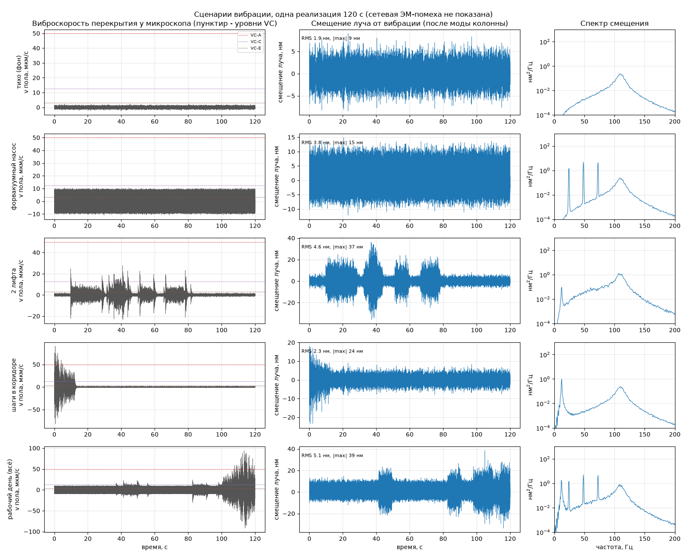
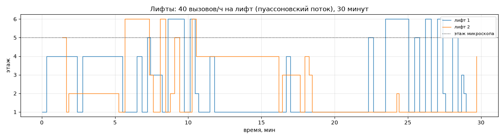
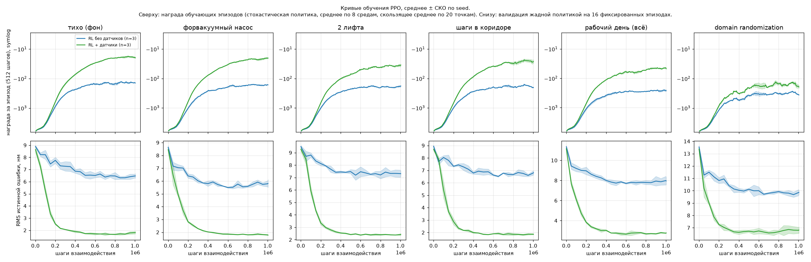
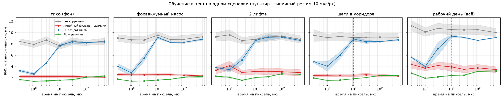
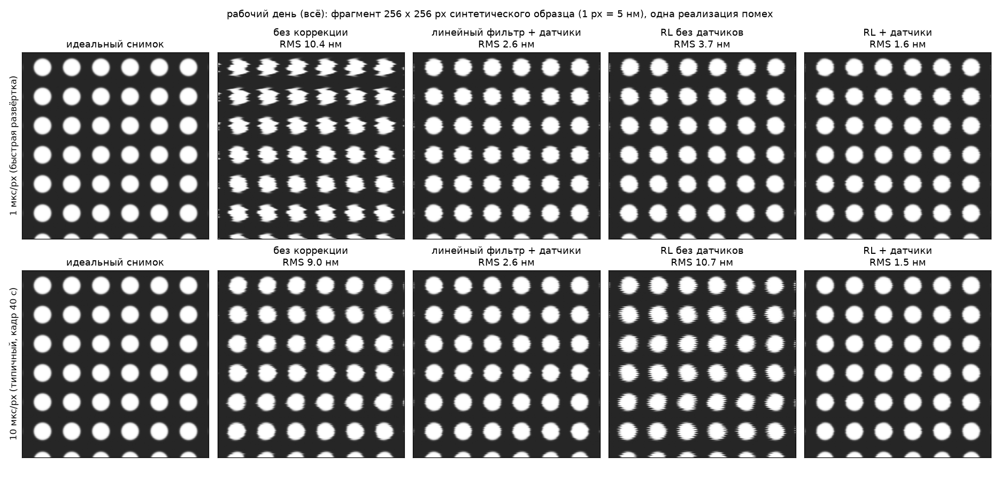
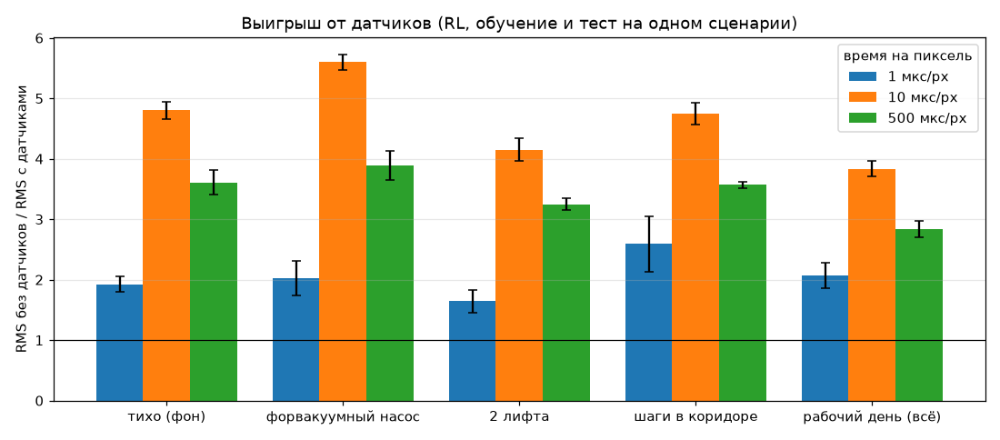
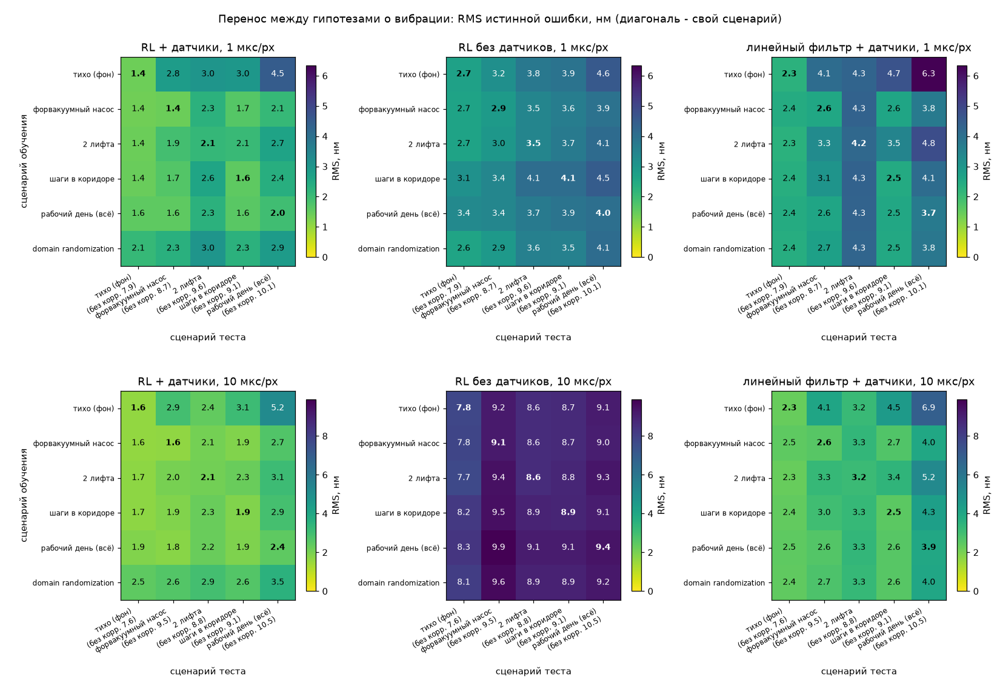
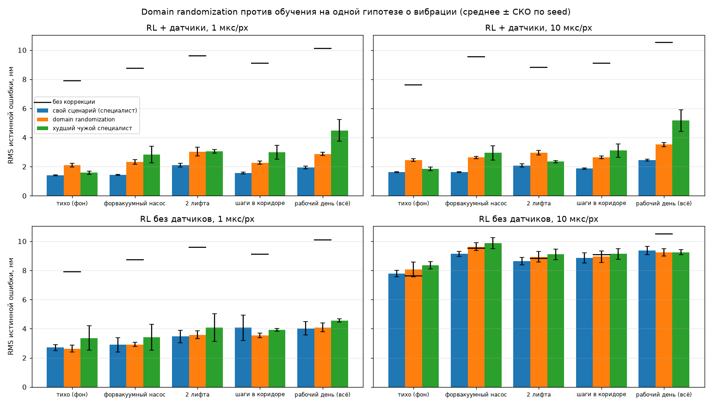
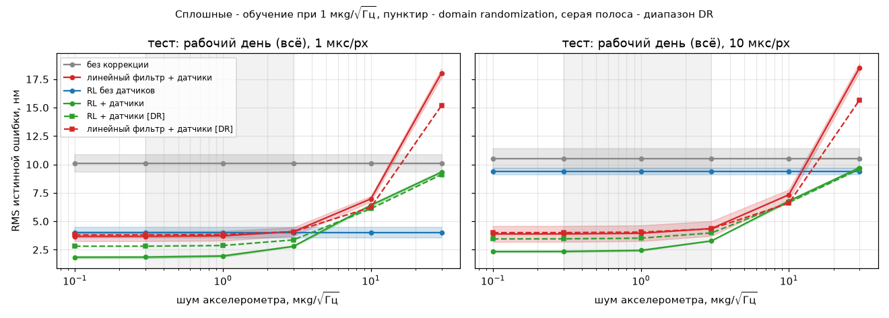
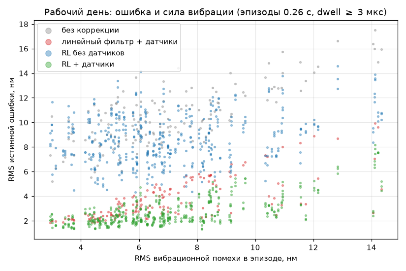

#МИФИ #SkillFactory #RL
# SEM-Beam-Gym: среда для исследования коррекции луча SEM при внешних помехах

Итоговый проект по RL, **трек 2** (собственная предметная область).

**Описание.** Среда Gymnasium, в которой агент корректирует отклонение луча растрового электронного микроскопа (SEM) во время регистрации кадра. Помехи - электромагнитная от сети и вибрационная от здания. Сценарий помех собирается из физических блоков: источники вибрации, здание, виброизоляция, колонна электронного микроскопа, сеть, датчики. Таким образом, другой исследователь может смоделировать свою лабораторию. Ноутбук `notebooks/pipeline.ipynb` демонстрирует, что даёт RL-регулятор на пяти "типичных" сценариях.

**Мотивация.** На установке нет ни магнитометра, ни акселерометра. Прежде чем их ставить, нужно понять, даст ли регулятор на их сигналах выигрыш в качестве снимка, при каких режимах съёмки и при каких источниках вибрации. Помехи и сигналы датчиков синтетические: работа отвечает на вопрос "при каких условиях это имеет смысл", а не доказывает выигрыш на конкретной установке.

> **Статус.** Полная матрица (36 запусков PPO, оценка 5 сценариев x 7 dwell x 30 эпизодов) выполнена. Результаты и проверка гипотез - в разделе 7. Гипотезы (раздел 1) зафиксированы до обучения.

**Пошаговая демонстрация** с графиками, объяснениями и выводами - [notebooks/pipeline.ipynb](notebooks/pipeline.ipynb).

**Коротко о результате.** Датчики снижают ошибку в 3.8-5.6 раз в типичном режиме 10 мкс/px. Агент без датчиков почти ничего не исправляет: сетевая помеха по изображению не видна. RL + датчики лучше линейного фильтра с тем же окном 8 мс, но линейный фильтр с окном 64 мс лучше обоих ($\approx$ 1 нм против 1.6-2.4 нм): узкое место - память, а не нелинейность. Domain randomization гипотезу 5 не подтвердил.

## 1. Вопрос, гипотезы, метрика, план

**Исследовательский вопрос.** Насколько снижается ошибка позиции луча, если RL-агент получает сигналы магнитометра и акселерометра, по сравнению с агентом, который видит только сам кадр? Как этот выигрыш зависит от режима съёмки (время на пиксель) и от природы вибрации?

**Гипотезы** (зафиксированы до обучения):

1. *Основная.* Во всех сценариях датчики снижают ошибку в типичном (10 мкс/px) и медленном режимах. Обратная связь по изображению запаздывает на строку (20 мс...1 с), а сетевая помеха при строке 20 мс одинакова во всех строках и по изображению не видна вовсе.
2. *Природа вибрации.* На быстрой развёртке ($\leq$ 1 мкс/px) выигрыш от датчиков зависит от предсказуемости вибрации. Для тонального насоса он мал: его можно предсказать по истории сдвигов строк. Для импульсных и нестационарных источников (шаги, старт и остановка лифта) выигрыш сохраняется: начало события по изображению видно только с опозданием.
3. *Перенос.* Агент, обученный на "тихом" сценарии, заметно теряет качество на сценариях с событиями. Агент, обученный на сценарии "рабочий день" (все источники сразу), ближе всех к лучшему результату на каждом сценарии.
4. *RL против классики.* Связь "ускорение рамы -> смещение луча" в модели линейна, поэтому линейный фильтр на датчиках будет близок к RL + датчики. Преимущество RL ожидается только там, где помогает обратная связь по изображению (быстрая развёртка).
5. *Domain randomization.* Агент, обученный на рандомизированных сценариях (случайный набор источников, их амплитуды, частоты колонны и перекрытия, шумы датчиков), на каждом фиксированном сценарии немного уступает специалисту этого сценария ($\leq$ 15 % по RMS), но заметно превосходит худшего "чужого" специалиста. Он также устойчивее к шуму акселерометра в пределах диапазона рандомизации.

**Метрика.** RMS истинной ошибки позиции луча, нм (геометрическая точность снимка). Дополнительно: видимый межстрочный сдвиг (что заметно глазу), доля времени с ошибкой > 1 px, уровень помехи в эпизоде (для анализа по силе событий).

**План сравнения.**
- *Фактор* - наблюдение: агент без датчиков (базовое условие) или агент с датчиками (экспериментальное). Всё остальное одинаково: среда, награда, сеть, PPO, бюджет 1M шагов, процедура оценки.
- *Второй фактор* - сценарий вибрации при обучении: 5 фиксированных сценариев + domain randomization. На каждом обучаются оба условия, по 3 seed: 36 запусков.
- *Оценка.* Каждый агент проверяется на **всех** 5 фиксированных сценариях (матрица "обучение x тест"), при семи значениях dwell от 0.3 до 500 мкс/px, по 30 фиксированных тестовых эпизодов на точку. Агрегаты - среднее $\pm$ СКО по seed и IQM.
- *Бейзлайны:* без коррекции, линейный фильтр на датчиках, подогнанный на том же сценарии обучения.
- *Отдельно:* требование к шуму акселерометра, 0.1-30 мкg/$\sqrt{\mathrm{Гц}}$, тест на сценарии "рабочий день": агенты, обученные на сценарии "рабочий день" (шум 1 мкg/$\sqrt{\mathrm{Гц}}$), и агенты с domain randomization (0.3-3 мкg/$\sqrt{\mathrm{Гц}}$).

Параметры съёмки: 
- кадр 2000x2000 px
- время экспозиции в точке (`dwell`) обычно 40 с на кадр (10 мкс/px, строка 20 мс). Диапазон - от 0.3 мкс/px (кадр 1.2 с) до 1 с на строку (500 мкс/px, кадр $\approx$ 33 мин).

## 2. Модель помех (упрощенная, но приближена к реальной - не является оцениваемой частью проекта, можно пропустить)

### Цепочка вибрации ([disturbances.py](src/sem_beam_gym/disturbances.py))

```
источники вибрации --> виброскорость перекрытия v(t), мкм/с (вклады складываются)
                    --> ускорение перекрытия a = dv/dt
                    --> виброизоляция (опц.) --> ускорение рамы --> акселерометр
                    --> мода колонны (кинематическое возбуждение) --> смещение луча, нм
```

Амплитуды источников задаются виброскоростью перекрытия в точке установки микроскопа, то есть в тех же единицах, что и критерии VC для помещений чувствительного оборудования (VC-A = 50, VC-C = 12.5, VC-E = 3.1 мкм/с). Удары (шаги, тормоз лифта, двери) возбуждают собственную моду перекрытия (12 Гц, $\zeta$ = 0.03). Затухание с расстоянием - $1/(1 + r/r_0)$.

**Здание** (`Site`): 6 этажей по 3.5 м, микроскоп на 5-м этаже.

**Колонна** (`Column`): одна мода "колонна относительно столика", 110 Гц, $\zeta$ = 0.05. Уравнение:
$$x'' + 2\zeta\omega x' + \omega^2 x = -a$$
Ниже резонанса $x \approx -a/\omega^2$, у резонанса усиление в $1/(2\zeta) = 10$ раз.

**Виброизоляция** (`Isolation`): по умолчанию нет (микроскоп стоит на полу). Можно задать пассивную опору, например `Isolation(freq=2.5)`.

### Источники вибрации

|Блок|Физика (без фанатизма)|Основные параметры по умолчанию|
|---|---|---|
|`Ambient`|Фон здания: транспорт, вентиляция - полосовой шум 4-100 Гц|0.5-1 мкм/с|
|`ForevacuumPump`|Пластинчато-роторный насос в соседней комнате: 4-полюсный асинхронный двигатель, 1500 об/мин минус скольжение $\rightarrow f \approx$ 23.8-24.6 Гц, гармоники x1 (дисбаланс), x2 (проход двух пластин), x3, медленный дрейф частоты $\pm 0.05$ Гц|4-8 мкм/с|
|`Elevators`|2 лифта, машинное отделение на крыше. Вызовы - пуассоновский поток (40/ч на лифт). Вызов: этаж посадки (50 % - первый) $\rightarrow$ назначение (с первого - любой, с остальных 70 % вниз), очередь вызовов. Движение - трапециевидный профиль (1 м/с, $0.8\text{ м/c}^2$), стоянка с дверями 4-9 с. Вклады: шум направляющих $\propto$ скорости кабины и близости к 5-му этажу, машина во время движения, удары тормоза при старте и остановке, удары дверей|шахта в 15 м, направляющие 15, машина 10 мкм/с на $r_0$ = 3 м, тормоз 150, двери 60 мкм/с (пик)|
|`Footsteps`|Пешеходы в коридоре 5-го этажа - пуассоновский поток (60/ч), проходят коридор 40 м со скоростью 1.1-1.6 м/с и частотой шага 1.7-2.2 Гц. Каждый шаг - удар по перекрытию, затухающий с расстоянием до микроскопа|комната в 5 м от линии движения, 200-600 мкм/с (пик) на $r_0$ = 2 м|

Процессы, которые идут и до начала окна моделирования (очередь лифта, проход человека), досчитываются с момента -lookback, поэтому эпизод - "случайный момент рабочего дня".

### Сеть и датчики

- `Mains` - ЭМ-помеха: 50 Гц + гармоники 150 и 250 Гц, амплитуды 6-14 / 2-6 / 1-3 нм, случайные фазы, частота 49.9-50.1 Гц, медленная амплитудная модуляция $\pm15\%$.
- Магнитометр стоит не на оси колонны: усиление 1.0/0.8/0.6 и фаза 0.2/0.5/0.9 рад по гармоникам (экраны, вихревые токи). Шум 1 нм-экв. на отсчёт.
- Акселерометр стоит на раме микроскопа и измеряет ускорение рамы, а не смещение луча: чтобы получить смещение, нужно знать модель колонны. Шум 1 мкg/$\sqrt{\mathrm{Гц}}$.

### Типичные сценарии ([scenarios.py](src/sem_beam_gym/scenarios.py))

|Сценарий|Источники|Смещение луча от вибрации за 0.25 с: медиана / p90 / p99, нм|
|---|---|---|
|`quiet` - ночь|фон|2.7 / 3.6 / 4.3|
|`pump`|фон + форвакуумный насос|5.2 / 5.8 / 6.2|
|`elevators`|фон + 2 лифта|3.2 / 7.2 / 12.0|
|`footsteps`|фон + люди в коридоре|3.6 / 10.7 / 16.9|
|`building` - рабочий день|все источники|7.9 / 10.9 / 15.1|

(1 px = 5 нм, плюс сетевая помеха $\approx$ 7-9 нм RMS во всех сценариях)

Сценарий только для обучения - `randomized` (domain randomization, класс `Randomized`): в каждом эпизоде фон + каждый из трёх источников с вероятностью 0.5, амплитуды x0.5...x2, колонна 80-140 Гц, $\zeta=0.03-0.08$, перекрытие 9-16 Гц, шум акселерометра 0.3-3 мкg/$\sqrt{\mathrm{Гц}}$, магнитометра 0.5-2 нм.





### Как задать свою ситуацию

```python
from dataclasses import replace

import numpy as np
from sem_beam_gym.disturbances import Ambient, Footsteps, Isolation, Sensors, Site
from sem_beam_gym.env import BeamEnv
from sem_beam_gym.scenarios import SCENARIOS, Scenario

# свой этаж и коридор, микроскоп на пневмоопорах, дешёвый MEMS-акселерометр
my = Scenario(
    "my_lab",
    vibration=(Ambient(rms_um_s=(1, 2)), Footsteps(walkers_per_hour=200, room_offset=2.0)),
    site=Site(floors=3, microscope_floor=1, slab_freq=18.0),
    isolation=Isolation(freq=2.5),
    sensors=Sensors(acc_noise_ug=30),
)
env = BeamEnv(sensors=True, scenario=my)

# свой источник: любой объект с методом floor_velocity(rng, n, fs, site) -> мкм/с
class Compressor:
    def floor_velocity(self, rng, n, fs, site):
        t = np.arange(n) / fs
        on = (t % 600) < 240 # 4 минуты работы из 10
        return 5.0 * on * np.sin(2 * np.pi * 49.0 * t)

SCENARIOS["compressor"] = replace(SCENARIOS["quiet"], name="compressor",
                                  vibration=(Ambient(), Compressor()))
```

Свой сценарий сразу работает со средой и со всеми функциями пакета: `train.rollout`, `baselines.LinearPolicy.fit`, `PPO` из Stable-Baselines3. Пример с обучением и оценкой - в [notebooks/pipeline.ipynb](notebooks/pipeline.ipynb). Чтобы сценарий попал в общий конвейер `sem-beam` (обучение, матрица оценки, графики), его нужно добавить в `SCENARIOS` в [scenarios.py](src/sem_beam_gym/scenarios.py): шаги конвейера запускаются отдельными процессами.

## 3. Постановка задачи

**POMDP, а не MDP.** Полное состояние среды - фазы и амплитуды сетевых гармоник, состояние моды колонны и перекрытия, положение лифтов, пешеходы, состояние катушки. Агенту оно недоступно: он получает только наблюдение $o_t$ (частично наблюдаемый марковский процесс). В наблюдение добавлена история - последние 16 шагов (аналог стека последних кадров в Atari). Основной фактор эксперимента (с датчиками или без) в этих терминах - *сколько стоит частичная наблюдаемость*: оба агента решают один и тот же POMDP, но с разным наблюдением. Сетевая помеха в типичном режиме (строка 20 мс = период сети) - компонента состояния, которая без магнитометра не наблюдаема ни при какой длине истории изображения.

**Почему model-free, а не динамическое программирование.** DP (Value/Policy Iteration) требует известной модели переходов и обозримого, обычно дискретного пространства состояний. Здесь пространства состояний и действий непрерывны, а переходы стохастичны и заданы только симулятором. Модель есть лишь как генератор эпизодов, поэтому задача решается model-free методом.

**Почему PPO, а не DQN.** Действие - непрерывное смещение отклоняющей системы. DQN работает с дискретными действиями и потребовал бы квантовать коррекцию (теряя точность или раздувая число выходов). Policy gradient с гауссовой политикой работает с непрерывным действием напрямую. PPO (actor-critic, clipped objective) выбран за устойчивость обновлений. GAE ($\lambda$ = 0.95) задаёт компромисс смещения и дисперсии оценки преимущества между TD и Монте-Карло. Короткий горизонт $\gamma$ = 0.9: награда здесь почти мгновенная (не "отложенная"), значимы лишь ~10 шагов, через которые действие влияет на ошибку (инерция катушки) и на сдвиги строк. Используются векторизованные среды (8 копий) и нормированные входы: каждый признак делится на фиксированный физический масштаб. Ортогональная инициализация, нормализация преимуществ и раздельные сети актора и критика в Stable-Baselines3 включены по умолчанию. Расписание learning rate не используется: кривые обучения выходят на плато задолго до конца бюджета.

**Sim2Real и domain randomization.** Агент учится в симуляции. На установку переносится политика. Источники разрыва sim2real - неточности моделирования, шумы и упрощённые модели сенсоров.
Поэтому:
- матрица "обучение x тест" - проверка переноса между гипотезами о вибрации (in/out-of-distribution)
- сценарий `randomized` - domain randomization: симуляция не точнее, а разнообразнее
- перебор шума акселерометра - устойчивость к модели сенсора

**Оценка.** Кроме среднего используется IQM: у эпизодов с лифтами и шагами тяжёлые хвосты, и IQM устойчивее к редким сильным событиям. Все политики оцениваются детерминированно (среднее гауссовой политики) на одних и тех же тестовых эпизодах, не использованных в обучении.

**Награда.** Привилегированная (истинная ошибка луча известна только в симуляторе). Для переноса на установку её пришлось бы заменить наблюдаемой - это отдельный вопрос о проектировании награды, оставленный на будущее.

## 4. Среда ([env.py](src/sem_beam_gym/env.py))

Одна ось (x - вдоль строки). Физическое время моделируется на сетке 20 кГц. Агент действует с частотой 2 кГц (шаг 0.5 мс) - это частота обновления корректирующего ЦАП, она не зависит от dwell. Катушка отрабатывает команду с постоянной времени 0.1 мс, предел $\pm$ 100 нм.

|||
|---|---|
|**Наблюдение**|Всегда: 16 последних действий, 16 последних сдвигов между строками, измеренных по изображению (корреляция участка строки с тем же участком предыдущей, шум 1 нм), своя коррекция строкой раньше, фаза сети (сигнал line sync, sin/cos для 1/3/5 гармоник), log dwell. С датчиками - ещё по 16 отсчётов магнитометра и акселерометра. 40 и 72 признака.|
|**Действие**|Смещение отклоняющей системы, непрерывное, [-1, 1] -> $\pm$ 100 нм.|
|**Награда**|$\frac{-mean(e^2)}{(10 нм)^2}$ за шаг, e = d - u - истинная ошибка позиции луча.|
|**Конец эпизода**|512 шагов (0.256 с). dwell - лог-равномерно в 0.3...500 мкс. Перед эпизодом без коррекции сканируется одна строка, чтобы было с чем сравнивать первую.|


**Почему такая награда.** Цель - чтобы каждый пиксель был снят в нужной точке образца. Квадрат отклонения луча - прямая мера геометрической ошибки снимка, а квадратичный штраф сильнее наказывает выбросы, которые глаз замечает как "зубцы". Награда привилегированная (в симуляторе истина известна). Это допустимо: обучение идёт в симуляции, а вопрос - о ценности *наблюдений*, а не о способе получить награду на установке.

**Базовые модели** ([baselines.py](src/sem_beam_gym/baselines.py)):
- *без коррекции* - нулевое действие (низшее качество),
- *линейный фильтр + датчики* - классическое активное шумоподавление: команда = линейная комбинация тех же 16+16 отсчётов датчиков и фазы сети, коэффициенты - гребневая регрессия на 200 эпизодах сценария обучения с известным смещением (те же привилегированные данные, что и в награде RL).

**Алгоритм.** PPO (Stable-Baselines3), MLP 128x128, 8 параллельных сред, 1M шагов, $\gamma$ = 0.9 (награда почти мгновенная). Остальное - в [train.py](src/sem_beam_gym/train.py).

## 5. Запуск и воспроизводимость

Проект собирается и запускается при помощи [uv](https://docs.astral.sh/uv/), код - пакет `sem_beam_gym` в `src/`.

```bash
uv sync # .venv: Python 3.12, зависимости из uv.lock, пакет в режиме editable

uv run sem-beam --quick # smoke тест всего конвейера (~5 мин на 8 потоках)
uv run sem-beam # полная матрица: 36 запусков PPO + оценка + графики
uv run sem-beam --skip-train # только оценка и графики по сохранённым runs/
uv run python -m sem_beam_gym.gallery # только рисунки сценариев (без агентов, секунды)

# ноутбук с полной демонстрацией: открыть с ядром из .venv или выполнить целиком
uv run jupyter nbconvert --to notebook --execute --inplace notebooks/pipeline.ipynb
```

Отдельные шаги - модули пакета: `python -m sem_beam_gym.<train|evaluate|linear_memory|plots|gallery|visualize>`. Артефакты (`runs/`, `results/`, `figures/`) пишутся в корень проекта независимо от текущей папки. Переменная `SEM_BEAM_ROOT` перенаправляет их в другое место (так сделан smoke тест, не затирающий результаты). 
Без uv: `pip install --extra-index-url https://download.pytorch.org/whl/cpu -e .` или `pip install ... -r requirements.txt`.

Полный запуск `uv run sem-beam --jobs 8` на ноутбуке (i7-11370H, 4 ядра / 8 потоков) ~ 1ч30мин. Один запуск PPO (1M шагов) в одиночку $\approx$ 2.7 мин на CPU. GPU (MX450) для этой задачи на 15 % медленнее: сеть маленькая, время уходит на шаги среды, поэтому обучение идёт на CPU.

||seed|
|---|---|
|обучение PPO|0, 1, 2 (на каждый сценарий и условие)|
|валидация во время обучения|50 000-50 003 x 4 dwell|
|тестовые эпизоды|100 000-100 029 (одни и те же для всех методов)|
|подгонка линейного фильтра|200 000-200 199|
|визуализация поведения|300 000|
|галерея сценариев|400 000|

Версии зависимостей - [uv.lock](uv.lock) и [requirements.txt](requirements.txt) (`uv pip freeze`), Python 3.12. torch - сборка для CPU (индекс PyTorch задан в [pyproject.toml](pyproject.toml)).

|Путь|Назначение|
|---|---|
|[notebooks/pipeline.ipynb](notebooks/pipeline.ipynb)|полная демонстрация: помехи, среда, бейзлайны, обучение, оценка, гипотезы, поведение, выводы|
|[src/sem_beam_gym/disturbances.py](src/sem_beam_gym/disturbances.py)|физические блоки: источники вибрации, здание, изоляция, колонна, сеть, датчики|
|[src/sem_beam_gym/scenarios.py](src/sem_beam_gym/scenarios.py)|`Scenario`, `Randomized`, моделирование помех, типичные сценарии|
|[src/sem_beam_gym/env.py](src/sem_beam_gym/env.py)|среда Gymnasium `BeamEnv`|
|[src/sem_beam_gym/baselines.py](src/sem_beam_gym/baselines.py)|без коррекции, линейный фильтр|
|[src/sem_beam_gym/train.py](src/sem_beam_gym/train.py)|обучение PPO: сценарий x условие x seed|
|[src/sem_beam_gym/evaluate.py](src/sem_beam_gym/evaluate.py)|матрица оценки - `results/eval.csv`|
|[src/sem_beam_gym/linear_memory.py](src/sem_beam_gym/linear_memory.py)|проверка после эксперимента: линейный фильтр с историей 16...128 шагов|
|[src/sem_beam_gym/plots.py](src/sem_beam_gym/plots.py)|кривые обучения, сравнения, матрицы - `figures/`, `results/summary.md`|
|[src/sem_beam_gym/visualize.py](src/sem_beam_gym/visualize.py)|поведение агентов: снимки, траектории, спектр, профиль искажения|
|[src/sem_beam_gym/gallery.py](src/sem_beam_gym/gallery.py)|рисунки сценариев помех|
|[src/sem_beam_gym/main.py](src/sem_beam_gym/main.py)|весь конвейер (команда `sem-beam`)|
|[src/sem_beam_gym/paths.py](src/sem_beam_gym/paths.py)|каталоги артефактов относительно корня проекта|
|`runs/`, `results/`, `figures/`|обученные агенты, таблицы, рисунки полного запуска|

## 6. Какие результаты будут получены

После `uv run sem-beam` в `figures/` появятся:

|Рисунок|Что показывает|
|---|---|
|`learning_curves.png`|кривые обучения для каждого сценария, среднее $\pm$ СКО по seed: награда обучающих эпизодов и RMS на валидации|
|`dwell_by_scenario.png`|ошибка в зависимости от dwell, обучение и тест на одном сценарии|
|`sensor_gain.png`|во сколько раз датчики снижают ошибку: по сценариям, при 1 / 10 / 500 мкс/px|
|`matrix.png`|перенос: обучение на одной гипотезе о вибрации, тест на другой|
|`dr_vs_specialist.png`|domain randomization против специалиста и худшего чужого специалиста|
|`acc_noise.png`|требование к шуму акселерометра|
|`events.png`|ошибка эпизода в зависимости от силы вибрации в нём|
|`<сценарий>_images.png`|синтетические снимки решётки кругов для всех методов|
|`<сценарий>_distortion.png`|статичное искажение вдоль строки и "зубцы"|
|`<сценарий>_traces.png`, `<сценарий>_psd.png`|ошибка во времени и её спектр|

Таблицы - в `results/summary.md`.

## 7. Результаты и анализ

Все числа - RMS истинной ошибки позиции луча (нм) на 30 фиксированных тестовых эпизодах. Для RL - среднее по 3 seed. Полные таблицы с разбросом и IQM - [results/summary.md](results/summary.md). Разброс между seed мал: СКО по seed для RL + датчики обычно 0.03-0.15 нм (таблица "RMS по seed" в summary.md). Полученные различия ниже - на порядок больше этого разброса, поэтому их нельзя объяснить случайностью `seed` (если не оговорено иное).

### Обучение



Верхний ряд - награда обучающих эпизодов. Это логи `Monitor` стохастической политики, среднее по 8 средам. Нижний ряд - RMS ошибки жадной политики на фиксированных валидационных эпизодах.

- Все 36 запусков сошлись. Награда растёт от $\approx -6000$  (случайная политика: $\sigma= 37 нм$ ) до $\approx -20$  с датчиками и $\approx -200$  без них.
- На валидации RL + датчики выходит на плато к 0.4-0.5M шагов. Без датчиков агент учится медленнее и останавливается выше.
- Обучающая награда с датчиками растёт до конца бюджета, хотя валидация уже стоит. Вероятно, это сужается $\sigma$ гауссовой политики: исследовательский шум падает, а среднее действие почти не меняется. Для итогового (жадного) агента бюджета 1M хватает.

### Сводка: обучение и тест на одном сценарии

|сценарий|без коррекции, 10 мкс|RL без датчиков, 1 / 10 мкс|линейный фильтр, 10 мкс|RL + датчики, 1 / 10 мкс|
|---|---|---|---|---|
|тихо (фон)|7.62|2.70 / 7.77|2.29|1.41 / 1.62|
|форвакуумный насос|9.53|2.89 / 9.14|2.58|1.43 / 1.63|
|2 лифта|8.82|3.46 / 8.64|3.16|2.11 / 2.08|
|шаги в коридоре|9.10|4.07 / 8.87|2.50|1.57 / 1.87|
|рабочий день (всё)|10.52|4.02 / 9.37|3.95|1.95 / 2.44|





### Видимый сдвиг строк и доля выбросов

Две дополнительные метрики из раздела 1, полные таблицы - в [results/summary.md](results/summary.md).
При 500 мкс/px межстрочный сдвиг не определён: строка длиннее эпизода.

|тест, 10 мкс/px|без коррекции|линейный фильтр|RL без датчиков|RL + датчики|
|---|---|---|---|---|
|тихо: сдвиг строк, нм / доля > 1 px|2.35 / 55 %|1.98 / 3.4 %|1.69 / 56 %|1.07 / 1.0 %|
|рабочий день: сдвиг строк, нм / доля > 1 px|6.78 / 65 %|3.66 / 19 %|2.74 / 62 %|1.74 / 6.0 %|

- **Видимое и истинное расходятся.** На тихом фоне без коррекции истинная ошибка 7.6 нм, а видимый сдвиг строк всего 2.35 нм. Почти всю ошибку даёт сеть, а она в каждой строке одинакова. Снимок выглядит ровным, но геометрически искажён: "зубцов" нет, есть неподвижное искажение вдоль строки ([quiet_distortion.png](figures/quiet_distortion.png)).
- **Агент без датчиков** уменьшает именно видимый сдвиг ($2.35 \rightarrow 1.69 \text{ нм}$), но доля времени с ошибкой > 1 px не меняется ($55 \rightarrow 56 \text{ \%}$). Он исправляет только то, что видно по изображению.
- **Линейный фильтр** на событиях даёт тяжёлый хвост. На сценарии "рабочий день" его средняя ошибка в 1.6 раза больше, чем у RL, а доля выбросов - в 3 раза (19 % против 6 %).

### H1 (датчики помогают в типичном и медленном режимах) - подтверждена

При 10 мкс/px датчики снижают ошибку RL в 3.8-5.6 раза, при 500 мкс/px - в 2.8-3.9 раза ([sensor_gain.png](figures/sensor_gain.png)). Без датчиков агент при dwell $\geq$ 10 мкс/px почти не лучше отсутствия коррекции (7.77 против 7.62 нм в тихом сценарии, 9.37 против 10.52 на сценарии "рабочий день"). Механизм тот, что предполагался: строка длится 20 мс и больше, сетевая помеха в каждой строке одна и та же, и по сдвигу строк её не видно. Вибрация видна с опозданием на строку. Без датчиков коррекция работает только на быстрой развёртке ($\leq$ 3 мкс/px).



### H2 (на быстрой развёртке выигрыш зависит от природы вибрации) - подтверждена частично

При 1 мкс/px выигрыш от датчиков (во сколько раз падает RMS): тихо 1.9, насос 2.0, лифты 1.65, шаги 2.6, рабочий день 2.1.

- *Насос.* Подтверждено: тональная вибрация предсказуема по изображению. Агент без датчиков на насосе почти так же хорош, как на тихом фоне (2.89 против 2.70 нм), и датчики добавляют к насосу ровно столько, сколько к фону.
- *Шаги.* Подтверждено: импульсы без датчиков видны поздно (4.07 нм), датчики дают наибольший выигрыш (2.6 раза).
- *Лифты.* Не подтверждено: выигрыш наименьший. Лифты прибавляют к ошибке $\approx 0.7 \text{ нм}$ и без датчиков, и с датчиками. Вероятное объяснение - короткое окно наблюдения: лифты и рабочий день сильнее всех выигрывают от более длинной истории линейного фильтра (см. H4). Отдельно для RL это не проверено.

### H3 (перенос между гипотезами о вибрации) - подтверждена



- Агент, обученный на тихом фоне, на сценариях с событиями теряет в 2.1-2.3 раза: на сценарии "рабочий день" 4.49 нм против 1.95 у специалиста (1 мкс/px), 5.16 против 2.44 (10 мкс/px). Это всё равно примерно вдвое лучше, чем без коррекции (10.1 и 10.5 нм).
- Агент, обученный на сценарии "рабочий день", отстаёт от лучшего результата на каждом тестовом сценарии не больше чем на 15 % (худший случай - тихий фон при 10 мкс/px: 1.85 против 1.61 у агента с насоса).
- Линейный фильтр с тихого фона на сценарии "рабочий день" даёт 6.3-6.9 нм. В абсолютных единицах - это хуже RL, хотя относительно своего специалиста он теряет меньше (в 1.7 раза).
- Агент без датчиков теряет при переносе до 25 %, заметно меньше агентов с датчиками. Всё, что он умеет, - обратная связь по изображению, а она от гипотезы о вибрации зависит слабо.

**Практический вывод:** обучать надо на сценарии, содержащем все ожидаемые источники. Обучение на "тихой" лаборатории опасно, если реально в здании есть события.

### H4 (RL $\approx$ линейный фильтр, т. к. связь линейна) - опровергнута в исходной форме, но суть верна

В основном эксперименте RL + датчики лучше линейного фильтра с тем же окном 16 шагов (8 мс) на 24-48 % при dwell $\leq$ 30 мкс. При 10 мкс/px это 29 % на тихом фоне и 38 % на сценарии "рабочий день". Дальше преимущество спадает. На тихом фоне при 100 мкс/px остаётся около 3 %, при 500 мкс/px фильтр уже лучше (2.12 против 2.32 нм). На сценарии "рабочий день" при 100 мкс/px ещё около 16 % (3.16 против 3.78 нм), при 500 мкс/px около 7 % (3.22 против 3.48 нм). Это указывает на источник выигрыша - обратную связь по сдвигу строк, которой у линейного фильтра нет, а не нелинейность политики.

Проверка после эксперимента ([linear_memory.py](src/sem_beam_gym/linear_memory.py), `results/linear_memory.csv`): тот же линейный фильтр с более длинной историей датчиков, вне среды, без инерции катушки.

|сценарий|16 шагов (8 мс)|32 (16 мс)|64 (32 мс)|128 (64 мс)|RL + датчики, 10 мкс|
|---|---|---|---|---|---|
|тихо (фон)|2.27|1.77|1.25|**0.90**|1.62|
|форвакуумный насос|2.58|1.92|1.33|**0.92**|1.63|
|2 лифта|3.36|2.53|1.70|**1.03**|2.08|
|шаги в коридоре|2.52|1.89|1.32|**0.92**|1.87|
|рабочий день (всё)|4.34|3.25|2.02|**1.08**|2.44|

С окном 64 мс классический фильтр в 1.8-2.3 раза лучше RL-агента. Причина физическая: мода колонны 110 Гц с $\zeta$ = 0.05 затухает за $1/(\zeta\omega) \approx 30 \text{ мс}$ и 8 мс истории не хватает, чтобы восстановить её состояние. Значит, главное ограничение и для RL, и для фильтра - окно наблюдения, а не способ построения регулятора. Оценка для фильтра немного оптимистична (не учтена инерция катушки, $\tau$ = 0.1 мс $\ll$ шага 0.5 мс), но разница слишком велика, чтобы её объяснить этим.

**Что это значит для установки:** первым шагом должен быть линейный компенсатор по акселерометру и магнитометру с памятью $\geq$ 64 мс. RL имеет смысл как надстройка над ним - с той же длинной историей и обратной связью по изображению. Это не проверено и вынесено в следующие шаги.

### H5 (domain randomization) - не подтверждена



- **Проигрыш специалисту** гораздо больше ожидаемых 15 %: на 41-63 % по RMS (например, рабочий день: 2.87 против 1.95 нм при 1 мкс/px, 3.52 против 2.44 при 10 мкс/px).
- **Сравнение с "чужими" специалистами.** DR-агент лучше худшего из них только там, где худший - агент с тихого фона. Агенту, обученному на сценарии "рабочий день", DR уступает на всех тестовых сценариях.
- **Устойчивость к шуму акселерометра** выше лишь в относительном смысле. На участке 0.3-3 мкg/$\sqrt{\mathrm{Гц}}$ при 1 мкс/px ошибка DR растёт на 20 %, а у агента со сценария "рабочий день" - на 51 %. При 10 мкс/px это 15 % против 40 %. По абсолютной ошибке DR хуже на всём этом диапазоне. При 10 мкg/$\sqrt{\mathrm{Гц}}$ и 1 мкс/px DR чуть лучше (6.11 против 6.41 нм), это в пределах разброса.
- **Без датчиков** DR-агент не хуже специалистов. Проигрывает только политика, которая использует датчики.

Альтернативные объяснения (не проверены, сформулированы после результата):
1. Все тестовые сценарии имеют номинальную физику (колонна 110 Гц, перекрытие 12 Гц, шум акселерометра 1 мкg/$\sqrt{\mathrm{Гц}}$). DR платит за устойчивость к вариациям, которых в тесте нет. Честное сравнение требует теста с рандомизированной физикой.
2. За 8 мс истории частоту колонны по наблюдению не определить, и политика вынуждена усреднять фильтр по 80-140 Гц. Против этого говорит то, что линейный фильтр, подогнанный на DR, почти не хуже специалиста (2.40 против 2.29 нм на тихом фоне). Иными словами, RL с DR потерял именно своё преимущество над линейным фильтром.
3. Задача с DR труднее для PPO при том же бюджете. Кривая обучения DR вышла на плато к 0.4M шагов, так что одно увеличение бюджета вряд ли поможет. Возможна проблема масштаба наблюдений (шум датчиков меняется от эпизода к эпизоду, нормализации наблюдений нет).

### Требование к акселерометру



- До 1 мкg/$\sqrt{\mathrm{Гц}}$ ошибка почти не зависит от шума. При 3 мкg/$\sqrt{\mathrm{Гц}}$ у агента со сценария "рабочий день" она вырастает на 35-45 %.
- При 1 мкс/px датчики теряют смысл около 5 мкg/$\sqrt{\mathrm{Гц}}$: RL + датчики уравниваются по качеству с агентом без датчиков. При 10 мкс/px порог выше - около 30 мкg/$\sqrt{\mathrm{Гц}}$.
- RL при сильном шуме деградирует мягко и сходится к уровню агента без датчиков. Линейный фильтр усиливает шум: при 30 мкg/$\sqrt{\mathrm{Гц}}$ он даёт 18 нм, хуже, чем без коррекции (10.5 нм).

**Требование для установки:** акселерометр с шумом $\leq$ 1 мкg/$\sqrt{\mathrm{Гц}}$ в полосе вибраций (единицы-сотни Гц). Это класс сейсмических/пьезоакселерометров, не дешёвых MEMS.

### Сила событий



RL + датчики держит 2-3 нм до вибрационной помехи $\approx$ 8 нм RMS в эпизоде, затем ошибка растёт до 4-8 нм в самых сильных эпизодах (старт или остановка лифта, шаги у двери). Линейный фильтр растёт раньше и круче. Таких эпизодов мало (раздел 8), поэтому средние метрики их недооценивают.

### Итог по исследовательскому вопросу

В принятой модели помех магнитометр и акселерометр **реально повышают качество снимка**. В типичном режиме 10 мкс/px RMS падает с 7.6-10.5 нм до 1.6-2.4 нм, то есть ниже 1 px (5 нм). Без датчиков ни RL, ни что-либо ещё в этом режиме сеть не уберёт. Но выигрыш даёт в первую очередь сам сигнал датчиков, а не RL. Классический линейный компенсатор с достаточной памятью справляется лучше, чем RL-агент с окном 8 мс. RL полезен там, где нужно совместить датчики с обратной связью по изображению (быстрая развёртка).

### Следующие шаги

- RL с длинной историей (64-128 шагов) или рекуррентной политикой.
- Residual RL поверх линейного компенсатора с длинной памятью.
- Тест с рандомизированной физикой колонны - честная проверка DR.
- Нормализация наблюдений (VecNormalize) для DR.

## 8. Известные ограничения модели

- Помехи, связь датчиков с лучом и их шумы - модель, а не измерения. Уровни источников выбраны правдоподобными (единицы-десятки нм), но не измерены на установке.
- Одна ось (x). Нет обратного хода луча, теплового дрейфа (важен для 33-минутного кадра), гистерезиса катушек. Колонна - одна мода.
- Связь датчиков с лучом и параметры колонны фиксированы (одна "установка") и в обучении, и в тесте.
- Награда привилегированная: на установке истинная ошибка неизвестна. Чтобы перенести агента, нужна калибровка модели (sim-to-real) или обучение по наблюдаемой награде.
- Оценка сдвига строк идеализирована: предполагается информативный образец и постоянный шум 1 нм.
- В тестовой сетке все dwell $\geq$ 10 мкс/px дают строку, кратную периоду сети (20, 60, 200 мс, 1 с), поэтому "слепое пятно" агента без датчиков покрывает весь медленный диапазон. Для некратных разверток (например 12 мкс/px) он будет видеть часть сетевой помехи.
- Окно наблюдения - 16 шагов (8 мс) для всех методов. Это ограничивает и RL и линейный фильтр (раздел 7, H4).
- Эпизод длится 0.256 с, поэтому редкие события (старт лифта, шаг рядом) попадают в небольшую долю обучающих и тестовых эпизодов.
